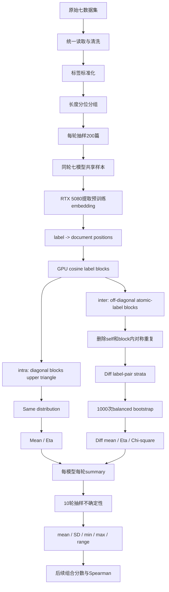

# Standardizing 两日工作与方法变更完整记录

**记录日期：** 2026-11-03  
**项目目录：** `/home/amyliu/Desktop/GR`  
**核心文件：** `Standardizing/finetuning.ipynb`、`Standardizing/RankPrediction.ipynb`  
**研究目标：** 将七个文本分类数据集的清洗、完整微调、模型初始选择、指标计算和不确定性实验统一到一套可比较、可复现、可恢复的流程中。

---

## 1. 本轮工作的总体范围

这两天的工作从“让七个数据集能够运行”推进到了“明确每一步统计对象、统一计算规则并保存可复现实验结果”。工作横跨以下层面：

1. 检查并统一七个数据集的读取、缺失值、重复文本和标签结构；
2. 建立统一的五折完整微调框架；
3. 将单标签与多标签数据整理成相同的预测接口；
4. 重新审查 same-label 与 different-label cosine distribution 的定义；
5. 放弃以完整标签集合为 diff 类型的做法，改为原子标签索引；
6. 检查并量化多标签造成的重复计数及 same/diff 重叠；
7. 修复 cosine pair 中的自身比较和对称重复；
8. 将 embedding、cosine block 和 Eta 的主要计算放到 RTX 5080；
9. 为 Eta 加入显存感知的完整矩阵/分块自动选择；
10. 在当前算法下重新建立十轮 uncertainty test，并加入断点续跑和结果汇总。

本次没有修改原始数据文件。所有清洗、标签过滤、抽样和编码都在 DataFrame 副本或 Notebook 运行内存中完成。

---

## 2. 七个数据集及当前任务定义

| 数据集 | 当前任务 | 当前分类标签数 | 预测 pair 标签数 | 备注 |
|---|---:|---:|---:|---|
| Financial PhraseBank | 单标签 | 3 | 3 | 原 train/test 概念不再单独保留，统一进入五折 |
| Environmental Claims | 单标签 | 2 | 2 | 二分类 |
| AG News | 单标签 | 4 | 4 | Hugging Face dataset 的 train/test 合并后清洗 |
| ECtHR | 多标签 | 29 | 30 | 预测阶段为无 violation 文档增加 `__NO_VIOLATION__` pair 标签；它不是微调类别 |
| Ohsumed | 多标签 | 23 | 23 | 同一文档可能出现在多个类别目录，按文档 ID 聚合标签 |
| Rheology | 单标签 | 5 | 5 | train/dev 合并后重新五折 |
| arXiv | 多标签 | 9 | 9 | 仅保留原始频数最大的九类；移除其他标签；无九类标签的文档删除 |

清洗后已经核对的数据规模：

| 数据集 | 文档数 | 标签赋值总数 | 单标签文档 | 多标签文档 | 每篇最大标签数 |
|---|---:|---:|---:|---:|---:|
| Financial | 4,836 | 4,836 | 4,836 | 0 | 1 |
| EnvData | 2,647 | 2,647 | 2,647 | 0 | 1 |
| ACGNews | 127,502 | 127,502 | 127,502 | 0 | 1 |
| ECtHR | 10,999 | 15,634 | 7,483 | 3,516 | 8 |
| Ohsumed | 34,386 | 56,978 | 18,302 | 16,084 | 8 |
| Rheology | 2,006 | 2,006 | 2,006 | 0 | 1 |
| arXiv | 38,979 | 68,838 | 17,478 | 21,501 | 6 |

`total_label_assignments` 大于文档数并不是重复数据错误。对多标签任务，它等于所有文档标签数量之和：

\[
N_{assignments}=\sum_i |Y_i|.
\]

---

## 3. 数据读取与清洗代码的统一

### 3.1 统一文档结构

所有数据最终整理为相同核心列：

```text
document_id
text
labels
source_split / source_splits
source_document_ids
```

`label_list()` 负责：

- 将单标签值转为单元素列表；
- 将 list、tuple、set、NumPy array 转为去重后的字符串标签列表；
- 区分缺失标签 `None` 与有效空列表；
- 去除标签首尾空格；
- 不把缺失值静默转换成字符串 `"nan"`。

`to_frame()` 负责：

- 统一列名；
- 使用 `dataset:split:source_id` 生成可追踪 ID；
- 防止不同 split 中的局部 ID 冲突；
- 保留来源 split。

### 3.2 `clean_dataset()` 的主要逻辑

该函数执行：

1. 检测缺失文本；
2. 合并连续空白字符并去除首尾空格；
3. 检测清洗后空文本；
4. 检测缺失标签；
5. 按清洗后的文本识别重复；
6. 多标签数据将同文档标签取并集；
7. 单标签数据若同一文本对应冲突标签，则单独保存冲突记录，不静默选择标签；
8. 保留全部源文档 ID 和来源 split；
9. 验证最终文本和 `document_id` 唯一；
10. 输出 rejected、conflicts 和 cleaning summary。

### 3.3 特殊数据处理

#### Ohsumed

原始目录按 `Cxx` 类别组织，同一文档可能出现在多个目录。读取时先以文件名为文档 ID 聚合：

```python
row = ohsumed_documents.setdefault(
    path.name,
    {"id": path.name, "text": text, "labels": set()},
)
row["labels"].add(category_dir.name)
```

并检查同 ID 在不同目录下的文本是否完全一致，避免错误合并。

#### ECtHR

有效但没有 violated article 的文档在 fine-tuning 中保持全零多标签目标。在 prediction pair 构造阶段，给这些文档添加：

```python
__NO_VIOLATION__
```

目的只是让“无 violation–无 violation”和“无 violation–有 violation”的 pair 关系可定义。该标签不进入微调分类头。

#### arXiv

九大类别按原始文档层面的标签频次选择，而不是按展开后的重复行选择。当前九类为：

```text
cs.CV, cs.LG, stat.ML, cs.AI, eess.IV,
cs.RO, cs.CL, cs.NE, cs.CR
```

每篇文档只保留这九类中的标签；过滤后无标签的文档删除。一个文档只要含有任意一个九大类别就保留。

---

## 4. 统一 fine-tuning 框架

### 4.1 当前实际配置

`Standardizing/finetuning.ipynb` 当前代码中的设置为：

```python
epochs = 8
n_splits = 5
seed = 42
max_length = 128
train_batch_size = 16
eval_batch_size = 16
learning_rate = 2e-5
weight_decay = 0.01
optim = "adamw_torch"
lr_scheduler_type = "linear"
gradient_accumulation_steps = 1
max_grad_norm = 1.0
fp16 = False
bf16 = False
tf32 = False
threshold = 0.5
```

**关键现状：** 当前 fine-tuning 仍是 `max_length=128`。Rank prediction 当前是 `MAX_TOKEN=512`。此前讨论过将 fine-tuning 重跑为512以完全对齐，但该更改尚未反映在当前 `finetuning.ipynb` 的实际配置中。因此目前两个阶段并未完全统一最大输入长度。

### 4.2 训练数据准备

`prepare_training_data()` 统一完成：

- 建立 `training_text`；
- 保存可读标签 `label_names`；
- arXiv 在编码前执行九类过滤；
- 单标签任务建立整数 label ID；
- 多标签任务使用 `MultiLabelBinarizer` 建立 multi-hot；
- 单标签使用 `StratifiedKFold`；
- 多标签使用 `MultilabelStratifiedKFold`；
- 所有五折使用 `shuffle=True, random_state=42`；
- 验证每篇文档恰好作为验证数据一次；
- 为数据、类别和训练设置生成 SHA-256 fingerprint，避免误用旧结果。

### 4.3 训练与评估

七个模型统一为：

```text
BERT
SciBERT
LegalBERT
FinancialBERT
PharmBERT
AgricultureBERT
ChemicalBERT
```

完整训练数量：

\[
7\ datasets\times7\ models\times5\ folds=245\ fits.
\]

每次 fit 为8 epochs。

单标签模型使用 softmax/argmax；多标签模型由 Transformers 的 `multi_label_classification` 使用 BCE-with-logits loss，预测时 sigmoid 后以0.5阈值转为0/1。

收集指标：

- Accuracy；
- Hamming loss；
- Macro/Micro/Weighted F1；
- Macro/Micro/Weighted precision；
- Macro/Micro/Weighted recall；
- 多标签 samples F1；
- training loss；
- evaluation loss；
- 每折训练和验证时间。

### 4.4 GPU与恢复

`require_rtx5080()` 明确查找名称包含 `5080` 的 CUDA设备。没有5080时停止，不静默退回CPU。

每折保存：

```text
metrics.csv
predictions.npz
trained_model/
```

每个数据集保存：

```text
fold_assignments.csv
label_mapping.csv
training_settings.csv
```

全局保存：

```text
fold_results.csv
model_summary.csv
```

中断重跑会验证 fingerprint、metrics、predictions 和模型配置后跳过完整折。

---

## 5. Rank prediction 的基础统一

### 5.1 当前设置

```python
BATCH_SIZE = 64
MAX_TOKEN = 512
RANDOM_SEED = 42
NUM_REPETITIONS = 3
NUM_QUANTILES = 100
SAMPLE_SIZE = 200
TEXT_COL = "text"
LABEL_COL = "labels"
DEVICE = "cuda:0"
```

`NUM_REPETITIONS=3` 是普通默认设置；新 uncertainty 区域独立覆盖为10轮，没有修改这一全局默认。

### 5.2 `sample_from_length_groups()`

该函数：

1. 检查 `sample_size` 和 `num_quantiles` 是正整数；
2. 清除空文本；
3. 默认以空格分词数量作为长度；
4. 可通过 `length_fn` 改为 tokenizer token length；
5. 使用 `qcut` 建立最多100个长度分位组；
6. 相同长度不强制拆组；
7. 从每个长度组尽量均衡抽样；
8. 剩余名额从未选文档中补足；
9. 使用 `np.random.default_rng(random_seed)` 保证可复现；
10. 保留 `document_id`、`length` 和 `quantiles`。

当前分组长度是 whitespace word count，不是某个模型 tokenizer 的 token 数。这保证所有模型使用相同分组，但不是与单一 tokenizer 完全一致的长度定义。

### 5.3 `compute_embeddings()`

流程：

1. 使用每个 checkpoint 自带 tokenizer；
2. `padding=True`，按当前 batch 最长序列补齐；
3. `truncation=True, max_length=512`；
4. tokenizer 输出移动到 `cuda:0`；
5. `AutoModel` 在 RTX 5080 前向；
6. 读取 `outputs.last_hidden_state`；
7. 使用 attention mask 排除 padding token；
8. 对有效 token 做 masked mean pooling；
9. 每篇文档得到一个通常为768维的向量；
10. batch embedding 暂时移回CPU保存，降低模型前向阶段显存压力。

这一步使用预训练原始模型，不更新模型参数。它测量 fine-tuning 之前的 embedding 空间是否已经反映任务标签结构。

---

## 6. Same/Diff 方法经历的主要尝试

### 6.1 早期完整标签集合方案

早期方法把一篇文档的完整标签集合视为类型。例如：

```text
{C01}
{C01, C03}
{C02, C05, C07}
```

inter 的 diagnostic/bootstrap key 使用两个完整标签集合组成的 pair。因此 Ohsumed 的200篇样本出现约3,702种类型。

问题：23个原子标签的异标签组合理论上最多应为：

\[
\binom{23}{2}=253.
\]

3,702不是原子标签 pair 数，而是完整标签集合 pair 数。这导致 bootstrap strata 爆炸，并出现 same target size 小于 diff type 数的错误。

该方案已放弃。

### 6.2 共享标签数与不同标签数比较

曾尝试定义：

\[
s=|A\cap B|,\qquad d=|A\triangle B|.
\]

并令：

```text
same if s >= d
diff if s < d
```

相等归 same。它能令 same/diff 互斥，并近似对应 Jaccard 阈值0.5。

优点：每个文档对只进入一组。  
缺点：它仍然没有直接修正 bootstrap 使用完整标签集合 pair 的问题，而且研究解释变成“整体标签相似度占多数”，不是“每个原子标签关系”。

该方案随后被 label-first 设计替代。

### 6.3 “有相同即same、有不同即diff”的重叠方案

曾将文档对定义为：

- 至少共享一个标签就进入 same；
- 至少存在一个不同标签就进入 diff。

因此多标签文档对可以同时进入两组。完整数据上的重叠曾测得：

```text
ECtHR: 约20.76%全部文档对
Ohsumed: 约17.46%
arXiv: 约46.20%
```

该方案揭示了重叠规模，但仍然把分布定义放在文档标签集合层面。随后进一步改为按原子标签组织文档。

### 6.4 曾尝试的展开 DataFrame 方案

短暂尝试过将 DataFrame `explode` 为“一行一个 document-label membership”，并建立额外的 label-indexed DataFrame 和新函数。

发现的问题：

- 多标签文档被复制多次；
- 同一个 embedding 在不同标签行重复出现；
- same/diff 重叠并未自动消失；
- 容易将同一文档跨标签与自身配对；
- 额外 DataFrame 不是必要条件。

该尝试的新增函数和数据格已经删除，原 Notebook 恢复后重新设计。

### 6.5 当前 label-first 原子标签方案

当前不复制 embedding，而是建立：

```python
label -> original document positions
```

例如：

```python
{
    "L1": np.array([0, 1]),
    "L2": np.array([0, 2]),
    "L3": np.array([3]),
}
```

文档0可以同时出现在 L1 与 L2 下，但 embedding 仍只有一个。

---

## 7. 当前核心 prediction 函数的逐项修改

### 7.1 `convert_to_label_sets()`

旧输出是每篇文档的标签集合列表：

```python
[{"L1", "L2"}, {"L1"}, {"L3"}]
```

新输出是原子标签到文档位置的映射：

```python
{
    "L1": [0, 1],
    "L2": [0],
    "L3": [2],
}
```

新函数还会：

- 将字符串标签视为单标签；
- 将多标签转为 set，防止同文档同标签重复；
- 对空标签报错；
- 返回排序后的标签映射；
- 文档位置使用整数 NumPy array。

### 7.2 `create_cosine_similarity_matrix()`

旧版建立完整文档 cosine matrix。新版接受：

```python
embeddings
label_to_document_indices
```

并为每个无序标签组合建立 block：

```text
(L1, L1)
(L1, L2)
(L1, L3)
(L2, L2)
(L2, L3)
(L3, L3)
```

返回：

```python
{
    "cosine_matrices": ...,
    "document_indices": ...,
}
```

每个 block 同时保留行、列对应的原始文档位置，用于删除自身比较和对称重复。

最新 GPU 修改：

- embedding 明确移动到 `cuda:0`；
- L2 normalization 在 GPU；
- 标签 block 矩阵乘法在 GPU；
- block 计算完成后才 `.cpu().numpy()`；
- CUDA不可用时停止，不静默退回CPU。

### 7.3 `intra_label_cosine_distribution()`

对每个 `(label, label)` 方阵只取 `k=1` upper triangle：

```python
np.triu_indices(n, k=1)
```

目的：

- 删除主对角线 A–A；
- 删除 B–A，因为 A–B 已经保留；
- 同一标签内部每个文档对只出现一次。

输出保持：

```python
same_scores
scores_by_label
```

`same_scores` 是各标签内部 pair occurrence 的合并。若一对多标签文档共享多个标签，它会在多个 `scores_by_label` 中出现，这属于当前标签关系加权定义。

### 7.4 `inter_label_cosine_distribution()`

只读取两个不同原子标签的 block，因此标签类型最多为：

\[
\binom{L}{2}.
\]

处理步骤：

1. 跳过 `(L1,L1)` 这类对角标签 block；
2. 通过原始文档位置删除同一文档跨标签的 A–A；
3. 将文档 pair canonicalize 为 `(min_id,max_id)`；
4. 在每个原子标签 block 内删除 A–B/B–A 对称重复；
5. 空 block 不作为 bootstrap strata；
6. 返回 `diff_scores` 和 `scores_by_label_pair`。

此次检查发现并修复了一个明确错误：若 A、B 都同时属于 L1 与 L2，`(L1,L2)` block 原先会同时含 A–B 和 B–A。现在每个原子标签 block 内只保留一次。

### 7.5 当前标签关系加权的含义

跨不同原子标签组合的重复仍然保留。例如：

```text
A: [L1, L2]
B: [L3]
```

A–B 会贡献给：

```text
(L1,L3)
(L2,L3)
```

这不是函数重复执行，而是把不同原子标签关系分别计入。它意味着多标签文档具有更高关系权重。

同一文档对也可能同时属于 pooled same 和 pooled diff。例如：

```text
A: [L1,L2]
B: [L1,L3]
```

它们在 L1 下是 same，同时又参与 L2–L3 等 diff block。因此当前研究对象是标签关系分布，不是两个互斥的唯一文档对集合。

---

## 8. Duplicate 与 overlap 的精确统计

Notebook 最后的数据汇总格已改为与当前 label-first 算法一致，并使用组合频数公式，避免枚举数十亿个文档对。

定义：

\[
duplicate\ percentage=
\frac{occurrences-unique\ pairs}{occurrences}\times100\%.
\]

- `occurrences`：按标签或原子标签组合收集后的出现次数；
- `unique_pairs`：跨标签关系去重后的唯一文档对；
- block 内 A–A 和 A–B/B–A 已经先删除，不算作 duplicate。

当前完整数据结果：

| 数据集 | Same duplicate | Diff duplicate | Same/diff overlap，占全部唯一文档对 |
|---|---:|---:|---:|
| Financial | 0.00% | 0.00% | 0.00% |
| EnvData | 0.00% | 0.00% | 0.00% |
| ACGNews | 0.00% | 0.00% | 0.00% |
| ECtHR | 6.18% | 45.80% | 21.83% |
| Ohsumed | 5.43% | 61.26% | 17.71% |
| Rheology | 0.00% | 0.00% | 0.00% |
| arXiv | 17.86% | 60.45% | 50.87% |

原子 diff 类型检查：

```text
Financial: 3
EnvData: 1
ACGNews: 6
ECtHR: 435 = C(30,2)
Ohsumed: 253 = C(23,2)
Rheology: 10 = C(5,2)
arXiv: 36 = C(9,2)
```

该结果证明“完整标签集合类型爆炸”已解决，但“标签关系加权重复”和“same/diff overlap”仍然存在，并且已经被量化。

---

## 9. Eta 指标与性能优化

### 9.1 数学定义

当前 Eta 沿用 Patil-style estimator：

\[
\hat\eta=-Corr(\hat f_{-i}(X_i),\hat F_{-i}(X_i)).
\]

其中：

- `f_hat` 是 leave-one-out Gaussian KDE；
- `F_hat` 是 strict leave-one-out empirical CDF；
- bandwidth 默认使用 Silverman-style rule；
- `eta_bandwidth=None` 表示自动估计，不是没有 bandwidth。

最终组合主要使用 `|eta|` 或两个 `|eta|` 的差；signed Eta 保留用于方向诊断。

### 9.2 旧 CPU 实现的问题

旧实现建立完整：

```python
diffs = (x[None,:] - x[:,None]) / h
K = stats.norm.pdf(diffs)
indicators = ...
```

空间和时间复杂度均为：

\[
O(n^2).
\]

新版 arXiv 的200篇样本可能产生约14,274个 same occurrences：

\[
14274^2\approx2.04\times10^8.
\]

单个 float64 矩阵约1.6 GB，多个中间数组会进一步增加内存。bootstrap 又要重复1,000次 diff Eta。

### 9.3 与旧 arXiv uncertainty 实验的比较

数学定义相同。旧 `arXiv/rankPredict_uncertainty10.ipynb` 已经使用 RTX 5080、float64 和固定128行分块。当前 Standardizing 在此基础上进一步改为显存感知的自适应执行。

### 9.4 当前自适应 GPU Eta

现在：

1. 输入转换为 `torch.float64` CUDA tensor；
2. 读取 `torch.cuda.mem_get_info(cuda:0)`；
3. 估计完整 KDE matrix 峰值；
4. 若估计值不超过当前空闲显存的45%，使用完整GPU矩阵；
5. 否则按当前空闲显存的30%自动计算 chunk size；
6. KDE、CDF、correlation 均在 RTX 5080；
7. 只返回最终 Python float；
8. CUDA不可用时停止。

完整和分块路径使用同一公式。真实5080测试：

```text
full eta    = -0.03524047172378658
chunked eta = -0.03524047172378660
absolute difference = 2.08e-17
```

差异仅来自浮点运算顺序。

### 9.5 当前设备分工

| 阶段 | 设备 |
|---|---|
| Tokenization | CPU |
| BERT forward | RTX 5080 |
| Masked mean pooling | RTX 5080 |
| Cosine block normalization/matmul | RTX 5080 |
| Eta KDE/CDF/correlation | RTX 5080 |
| Bootstrap随机索引 | CPU |
| Histogram、CSV、pandas汇总 | CPU |

小型表格和随机索引留在CPU更合理，避免不必要的host/device传输。

---

## 10. Chi-square 与 bootstrap

### 10.1 `chi2_distance()`

两个分布使用完全相同的 bin edges，先归一化为概率：

\[
D_{\chi^2}(p,q)=\frac12\sum_i\frac{(p_i-q_i)^2}{p_i+q_i+\epsilon}.
\]

当前设置：

```python
bins = 50
value_range = (-1,1)
eps = 1e-12
```

固定 `(-1,1)` 合理，因为 cosine 已 clamp 到该范围。固定 bins 能保证不同模型与重复轮次之间可比。

### 10.2 `bootstrap_interlabel()`

每个模型每轮：

1. same distribution 固定；
2. target size 等于 `len(same_scores)`；
3. 获取当前原子 diff-label pair types；
4. 将 target size 尽量平均分给每个 label pair；
5. 每个 pair 内有放回抽样；
6. 重复1,000次；
7. 每次计算 diff mean、diff Eta、mean gap、Eta magnitude gap、chi-square；
8. 汇总 mean 和 SD。

当前保存：

```text
same_mean
same_eta
same_abs_eta
diff_mean / std
diff_eta / std
diff_abs_eta
mean_gap / std
abs_mean_gap
eta_gap / std          # signed diagnostic
eta_abs_gap / std      # |same eta|-|diff eta|
abs_eta_abs_gap        # ||same eta|-|diff eta||
chi2_distance / std
```

### 10.3 尚未解决的权重问题

same pooled distribution 按每个标签实际 pair 数量合并，因此大标签贡献更多。diff bootstrap 则对原子标签 pair 平均分配 target size，因此每种 label pair 权重近似相同。

这两边的权重原则不同。它不导致代码报错，但会影响统计解释。正式论文中必须说明，或后续统一 same 与 diff 的平衡规则。

---

## 11. `run_one_model()` 与 `metric_collect()`

### 11.1 `run_one_model()`

每个模型：

1. 从同一 `sampled_df` 读取文本和标签；
2. 计算一次预训练 embedding；
3. 计算 intra distribution；
4. 计算 inter distribution；
5. 运行1,000次 bootstrap；
6. 生成一行模型 summary；
7. 保留 same/diff 原始分布、按标签分组结果、bootstrap DataFrame、文档 ID 和精确样本副本。

当前一个性能优化机会尚未实施：intra 和 inter 各调用一次 `create_cosine_similarity_matrix()`，因此 cosine blocks 会计算两次。结果正确，但可以改为在 `run_one_model()` 中建立一次 blocks 并传给两个函数。

### 11.2 `metric_collect()`

该函数：

- 生成可复现但不同的 repetition seeds；
- 每轮只抽一次200篇；
- 同一轮7个模型共享完全相同样本；
- 输出标签覆盖；
- 记录每模型与每轮耗时；
- 保存 `summary_df`、`full_results` 和 repetition seeds；
- 检查最终行数等于 repetitions × models。

---

## 12. Uncertainty test 的重新建立

### 12.1 两层重复的区别

外层10轮：每轮重新抽200篇文档，测量文档抽样敏感性。  
内层1,000次 bootstrap：在当轮已计算的 diff cosine score 中重采样，测量当轮 diff 指标稳定性并平衡 label-pair strata。

```text
Dataset
  └─ repetition 1..10: new length-stratified document sample
       └─ same sample for all 7 models
            └─ 1000 diff-score bootstrap samples per model
```

### 12.2 新增设置

在 `### Uncertainty Test` 下新增独立配置：

```python
UNCERTAINTY_REPETITIONS = 10
UNCERTAINTY_MASTER_SEED = 42
UNCERTAINTY_SAMPLE_SIZE = 200
UNCERTAINTY_NUM_QUANTILES = 100
UNCERTAINTY_N_BOOTSTRAP = 1000
```

master seed 42 生成10个固定 repetition seeds，而不是简单使用42–51。每个数据集使用同一组 seed；由于数据池不同，实际抽到的文档不同。

### 12.3 实验规模

\[
7\ datasets\times10\ repetitions\times7\ models
=490\ model\ runs.
\]

每个 model run 又包含1,000次 bootstrap Eta。

### 12.4 断点续跑与保存

输出目录：

```text
Standardizing/results/rank_prediction_uncertainty10_label_first/
```

每个数据集完成10轮后立即保存：

```text
<dataset>_summary_10runs.csv
<dataset>_sampled_documents.csv
```

第二个文件保存每轮 seed、样本位置和 document ID。所有模型使用同一样本，因此只需要从该轮第一个模型保存一次 ID。

重跑时，仅当数据集文件包含完整70行、10轮和7模型时跳过。否则该数据集重新计算。

不保存庞大的 embedding 和临时 full_results；保存 summary 和样本身份后立即删除内存对象并清理 CUDA cache。

### 12.5 自动结果汇总

完成后生成：

```text
all_datasets_model_metrics_10runs.csv
model_metric_uncertainty_summary.csv
dataset_metric_stability.csv
important_findings.csv
IMPORTANT_FINDINGS.md
```

重点分析：

```text
same_mean
diff_mean
same_abs_eta
diff_abs_eta
abs_mean_gap
abs_eta_abs_gap
chi2_distance
```

对每个 dataset–model–metric 汇总十轮 mean、SD、min、max和range；再识别每个数据集中平均SD最大和最小的指标。

当前自动结论只覆盖指标抽样稳定性。若要计算每轮组合分数、预测排名、Spearman、排名翻转和F1 regret，还需将最终固定权重和最新 fine-tuning F1 目标接入该结果。

---

## 13. 当前运行状态与预计耗时

在记录时，uncertainty test 已由 VS Code Jupyter kernel 启动：

```text
GPU: NVIDIA GeForce RTX 5080
GPU utilization: 主要约88–89%
GPU memory: 约2.56 / 16.30 GB
GPU power: 约196 W
temperature: 约49°C
Python kernel state: running
```

30秒抽样显示 GPU 大部分时间保持约89%，一次短暂下降后恢复，未发现停滞。

预计：

| 范围 | 时间估计 |
|---|---:|
| 一个普通数据集的一轮7模型 | 约5–8分钟 |
| Financial 10轮 | 约50–80分钟 |
| ECtHR 10轮 | 约1.5–2.5小时 |
| Ohsumed 10轮 | 约1–2小时 |
| arXiv 10轮 | 约1.5–2.5小时 |
| 七数据集全部 | 约8–12小时，保守8–14小时 |

当前保存粒度为“一个数据集完整10轮”。在第一个数据集结束前中断会丢失该数据集本轮内存结果；完成一个数据集后重启会自动跳过它。

---

## 14. 已解决的问题

1. 七数据集读取列名和标签格式不一致；
2. train/dev/test 是否合并及如何重新五折；
3. 单标签整数编码和多标签 multi-hot 编码；
4. arXiv 从1,099类/大量原始类别转为固定九类；
5. Ohsumed 同文档多目录导致的标签聚合；
6. ECtHR 有效空标签文档的 pair 语义；
7. 完整标签集合导致3,702个 diff type；
8. 原子 diff type 上限恢复为 \(\binom L2\)；
9. intra 自身比较和对称重复；
10. inter 跨标签自身比较；
11. inter block 内 A–B/B–A 对称重复；
12. duplicate 与 overlap 的精确量化；
13. NumPy/SciPy Eta 未使用GPU；
14. Eta 完整矩阵显存风险；
15. GPU完整/分块两路径数值一致性验证；
16. uncertainty test 的10轮 seed、断点续跑和结果保存；
17. 所有模型在同一 repetition 使用相同文档样本。

---

## 15. 仍需决定或处理的问题

### 15.1 Fine-tuning 与 prediction 最大长度不一致

当前：

```text
fine-tuning max_length = 128
prediction MAX_TOKEN  = 512
```

若研究要求完全统一，需要将 fine-tuning 改为512并重新训练245 fits。由于显存压力，batch size 和 gradient accumulation 可能需要调整，但有效 batch size 应保持一致。

### 15.2 Same/diff不是互斥文档对集合

当前 label-first 方法研究标签关系。arXiv 约50.87%的唯一文档对同时出现在 pooled same 和 pooled diff。若论文声称比较两个独立文档群体，这一设计不成立；若论文明确研究原子标签关系，可以保留，但必须报告 overlap。

### 15.3 多标签关系重复带来的权重

Ohsumed 和 arXiv 的 diff duplicate 约60%。需要决定：

- 保留，解释为标签关系加权；
- 或对最终 pooled distribution 按唯一文档对去重；
- 或为每个文档对按出现次数加权归一化。

### 15.4 Same 与 diff bootstrap 权重不一致

需要决定是否：

- same 也按标签均衡采样；
- diff 改为按自然 pair 数比例采样；
- 或明确当前“一边自然加权、一边标签对均衡”的研究含义。

### 15.5 Cosine blocks 重复计算

当前 intra/inter 分别建立 blocks。可改为一次计算、两次消费，以降低运行时间。

### 15.6 组合权重与最新 F1 目标

当前 uncertainty 保存的是指标稳定性。后续需：

1. 使用当前统一 fine-tuning 的 Macro-F1；
2. 确定最终五指标组合权重；
3. 每轮计算组合分数与预测排名；
4. 报告每数据集十轮 Spearman mean/SD/range；
5. 报告关键模型对分数差、翻转次数和 F1 regret；
6. 用 leave-one-dataset-out 或 nested selection 检验系数稳定性。

### 15.7 置信区间的限制

10轮可以用于初步评估抽样波动，但对稳定的95% bootstrap置信区间通常仍偏少。十轮结果应报告 mean、SD、min/max和方向翻转；不应把“8/10轮”直接解释为80%真实概率。

---

## 16. 推荐的下一步顺序

1. 让当前十轮 uncertainty test 完成并检查所有CSV完整性；
2. 生成七数据集、七模型、十轮的指标稳定性表；
3. 比较 duplicate/overlap 与指标SD、Spearman失败是否相关；
4. 决定是否保留标签关系加权；
5. 统一 same/diff bootstrap weighting；
6. 决定 fine-tuning 是否必须从128重跑到512；
7. 接入最新 Macro-F1 与最终组合方程；
8. 完成逐轮 Spearman、排名翻转、pairwise score gap 和 F1 regret；
9. 最后进行外层 leave-one-dataset-out 权重稳定性分析；
10. 将方法、假设、重复计数和限制写入论文。

---

## 17. 当前方法的简化流程图



---

## 18. 解释结果时必须保留的边界

- 当前预测指标来自预训练 embedding，不是 fine-tuned embedding；
- 预测目标是提前估计哪个预训练模型更适合该任务；
- label-first pooled distribution 是标签关系加权，不等于唯一文档对的自然分布；
- duplicate 百分比不是源数据重复率；
- same/diff overlap 不是代码自比较错误，而是多标签关系定义的结果；
- 五折 SD 不是置信区间；
- 十轮抽样频率不是事件真实概率；
- Spearman 衡量预测排序关联，不直接衡量 uncertainty；uncertainty 来自 Spearman 或指标在重复实验中的变化；
- 不同数据集的 Macro-F1 不宜直接互相比较任务难度；
- 当前128/512长度不一致必须在最终方法中解决或明确披露。

---

## 19. 文件位置索引

```text
Standardizing/finetuning.ipynb
Standardizing/RankPrediction.ipynb

Standardizing/results/finetuning_8epochs_5fold/
  fold_results.csv
  model_summary.csv

Standardizing/results/rank_prediction_uncertainty10_label_first/
  <dataset>_summary_10runs.csv
  <dataset>_sampled_documents.csv
  all_datasets_model_metrics_10runs.csv
  model_metric_uncertainty_summary.csv
  dataset_metric_stability.csv
  important_findings.csv
  IMPORTANT_FINDINGS.md
```

本报告记录的是截至2026-11-03当前磁盘代码和已验证实验逻辑。后续若改变 same/diff 权重、最大长度、抽样规模、bootstrap次数或最终组合方程，应在本文件末尾继续追加版本记录，而不是覆盖本次定义。
